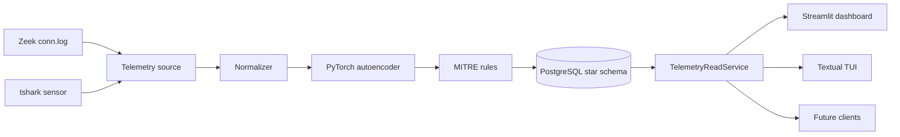

<p align="center">
  <a href="https://github.com/Geovanny001/Vortemis.io">
    
  </a>
</p>

<p align="center">
  <strong>Passive network anomaly detection and MITRE ATT&CK mapping for SOC teams.</strong>
</p>

<p align="center">
  Out-of-band Zeek and tshark telemetry, PyTorch reconstruction scoring, and a PostgreSQL star schema.
</p>

<p align="center">
  <a href="https://github.com/Geovanny001/Vortemis.io/actions/workflows/docker-build.yml">
    
  </a>
  
  
  
  
  
  
</p>

---

**Docs:** [Roadmap](docs/ROADMAP.md) | [Decisions](docs/DECISIONS.md) | [Security](docs/ops/SECURITY.md) | [Handoff](docs/handoff/2026-11-14.md)

**Source:** https://github.com/Geovanny001/Vortemis.io

**Status:** Active development. Ingestion and the read-side contract are stable; detection calibration is ongoing.

---

## Overview

Vortemis.io is a passive, out-of-band SOC telemetry platform. It reads Zeek `conn.log` files or a live `tshark` sensor, converts each flow into six features, and scores it with a PyTorch autoencoder.

Anomalies above the threshold are mapped to five MITRE ATT&CK network tactics. Results are stored in a PostgreSQL star schema and exposed through a Streamlit dashboard, a Textual TUI, and a presentation-neutral read service.

Payloads are never inspected. Only Layer 3 and Layer 4 metadata is processed.

## Highlights

- **Passive by design:** Zeek TSV/JSON and live tshark ingestion.
- **Six-feature flow model:** IAT, forward bytes, backward bytes, duration, PCR, and failed-connection flag.
- **MITRE mapping:** exfiltration, lateral movement, impact, reconnaissance, and command and control.
- **Multiple presentations:** Streamlit, Textual TUI, and a reusable read service for future clients.
- **Operational controls:** RBAC, login rate limiting, admin purge, healthcheck, and Docker CI.

## Architecture



The codebase follows a strict hexagonal architecture:

```text
domain <- application <- infrastructure <- entrypoints
```

The UI depends on `TelemetryReadService` and DTOs, not on SQLAlchemy or ORM models.

## Detection

Each flow is represented by:

```text
log1p(iat_ms), log1p(orig_bytes), log1p(resp_bytes),
log1p(duration), PCR, is_failed_conn
```

The autoencoder is trained on legitimate traffic. The anomaly score is a calibrated logistic transform of the reconstruction error, with a 95th-percentile threshold `tau` and a default `epsilon` of `0.70`.

| Tactic | ID | Signal |
|---|---|---|
| Exfiltration | `TA0010` | High PCR and large forward volume |
| Lateral Movement | `TA0008` | Private-to-private traffic on remote-access ports |
| Impact | `TA0040` | Very short IAT with failed or abnormal state |
| Reconnaissance | `TA0043` | `S0`/`REJ`, no response bytes, short duration |
| Command and Control | `TA0011` | Low-volume short-IAT traffic or common C2 ports |

## Quick start

### Docker

```bash
git clone https://github.com/Geovanny001/Vortemis.io.git
cd Vortemis.io
docker compose up --build
```

Open http://localhost:8501. The stack starts PostgreSQL, the seed/ingest service, and the Streamlit dashboard.

### Local

```bash
uv sync
uv run python scripts/seed_and_generate.py --generate-sample
uv run python -m vortemis.entrypoints.cli
uv run streamlit run src/vortemis/entrypoints/dashboard.py
```

Terminal UI:

```bash
uv run python -m vortemis.entrypoints.tui
```

Live sensor:

```bash
uv run python -m vortemis.infrastructure.zeek.live_sensor \
  --interface wlan0 --log-file conn.log
```

Configuration lives in [`.env.example`](.env.example). The values there are development defaults; rotate them before exposing the service.

## Presentations

- **Streamlit dashboard:** native login, RBAC, live sensor status, KPIs, MITRE matrix, forensic inspector, diagnostics, CSV export, and admin purge.
- **Textual TUI:** five KPIs, live table, top-risk hosts, inspector, and threshold controls.
- **Read service:** `TelemetryReadService`, DTOs, and ports for future desktop or web clients.

## Evaluation

CICIDS2017 is used for calibration experiments. Dataset and experimental checkpoints are not versioned.

| Model | ROC-AUC | Recall at 5% FPR |
|---|---:|---:|
| Shipped checkpoint | 0.694 | 0.00 |
| Larger autoencoder 6-32-8-32-6 | 0.868 | 0.560 |
| Supervised diagnostic | 0.998 | - |

The shipped checkpoint is not production-calibrated. See [the baseline report](docs/evidence/2026-11-14-p1-cicids2017-baseline.md).

## Security

- PBKDF2-HMAC-SHA256 with per-user salts and constant-time comparison.
- Five-minute login lockout after five failed attempts.
- Role-based access control for threshold changes and telemetry purge.
- Healthcheck endpoint and Docker Compose healthcheck.
- TLS reverse-proxy example in [`deploy/Caddyfile`](deploy/Caddyfile).
- Checklist in [`docs/ops/SECURITY.md`](docs/ops/SECURITY.md).

## Documentation

| Document | Purpose |
|---|---|
| [Roadmap](docs/ROADMAP.md) | Completed work and next steps |
| [Decisions](docs/DECISIONS.md) | Architecture decisions |
| [Security](docs/ops/SECURITY.md) | Rotation, TLS, and hardening |
| [Handoff](docs/handoff/2026-11-14.md) | Full engineering handoff |
| [Evidence](docs/evidence/2026-11-14-p0-ingestion.md) | P0, P1, UI/ops and read-side evidence |

## Contributing

- Keep the hexagonal boundaries: `domain <- application <- infrastructure <- entrypoints`.
- Keep source code, file names, and commit messages in English.
- Do not add `#` comments to Python or SQL source files.
- Run `uv run ruff check .` and `uv run pytest` before opening a pull request.
- Do not overwrite `models/vortemis_ae.pt`; use a separate path for experiments.

## License

Proprietary software developed by Carles Rivera and the Vortemis.io Team. See [LICENSE](LICENSE) and [AUTHORS.md](AUTHORS.md).
