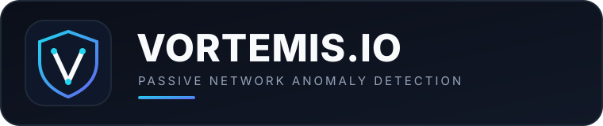
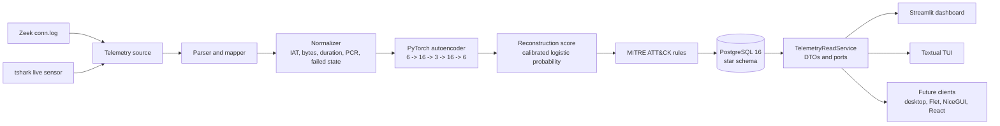

<p align="center">
  <a href="https://github.com/Geovanny001/Vortemis.io">
    
  </a>
</p>

<p align="center">
  <strong>Passive network anomaly detection and MITRE ATT&CK mapping for SOC teams.</strong>
</p>

<p align="center">
  Out-of-band Zeek and tshark telemetry, PyTorch reconstruction scoring, and a PostgreSQL star schema.
</p>

<p align="center">
  <a href="https://github.com/Geovanny001/Vortemis.io/actions/workflows/docker-build.yml">
    
  </a>
  
  
  
  
  
  
</p>

---

**Documentation:** [Roadmap](docs/ROADMAP.md) | [Architecture decisions](docs/DECISIONS.md) | [Security](docs/ops/SECURITY.md) | [Session handoff](docs/handoff/2026-11-14.md)

**Source code:** https://github.com/Geovanny001/Vortemis.io

**Status:** Active development. Ingestion and the read-side contract are stable. Detection calibration is an ongoing workstream.

---

## Overview

Vortemis.io is a passive, out-of-band SOC telemetry platform. It reads network flow metadata from Zeek `conn.log` files or a live `tshark` sensor, converts each flow into a six-dimensional feature vector, and scores it with a PyTorch autoencoder.

Anomalies above the configured threshold are mapped to one of five MITRE ATT&CK network tactics. Results are stored in a PostgreSQL star schema and exposed through a Streamlit dashboard, a Textual terminal UI, and a presentation-neutral read service.

The system never inspects payloads. It only processes Layer 3 and Layer 4 metadata.

## Key capabilities

| Capability | Description |
|---|---|
| Passive ingestion | Zeek TSV/JSON logs and a live tshark sensor |
| Flow features | IAT, forward bytes, backward bytes, duration, PCR, failed-connection flag |
| Detection | PyTorch autoencoder with reconstruction-error scoring |
| MITRE mapping | Exfiltration, lateral movement, impact, reconnaissance, command and control |
| Storage | PostgreSQL 16 star schema with async SQLAlchemy and asyncpg |
| Presentations | Streamlit dashboard, Textual TUI, and a presentation-neutral read service |
| Operations | RBAC, login rate limiting, admin purge, healthcheck, and Docker CI |

## Architecture



The codebase follows a strict hexagonal architecture:

```text
domain <- application <- infrastructure <- entrypoints
```

| Layer | Responsibility |
|---|---|
| `domain` | Entities and value objects with standard-library dependencies only |
| `application` | Use cases, query service, DTOs, and ports |
| `infrastructure` | Zeek parsing, PostgreSQL, SQL adapters, authentication, and maintenance |
| `entrypoints` | CLI, Streamlit dashboard, Textual TUI, and the composition root |

The UI depends on `TelemetryReadService`, not on SQLAlchemy or ORM models. The read contract is reusable by any future presentation.

## Detection engine

Each flow is represented by six features:

| Feature | Description |
|---|---|
| `log1p(iat_ms)` | Inter-arrival time from the same source IP |
| `log1p(orig_bytes)` | Forward bytes |
| `log1p(resp_bytes)` | Backward bytes |
| `log1p(duration)` | Flow duration in seconds |
| `PCR` | `(orig - resp) / (orig + resp + 1)` |
| `is_failed_conn` | `1` for `S0`, `REJ`, `RSTO`, or `RSTR` |

The autoencoder is trained only on legitimate traffic. The anomaly score is a calibrated logistic transform of the reconstruction error:

```text
error = mean((x_standardized - autoencoder(x_standardized))^2)
score = sigmoid(k * (error - tau) / tau)
```

`tau` is the 95th percentile of the training reconstruction error. The default threshold is `epsilon = 0.70`.

The shipped checkpoint is `models/vortemis_ae.pt`. It is protected and must not be overwritten by experiments.

### MITRE ATT&CK mapping

| Tactic | ID | Network rule summary |
|---|---|---|
| Exfiltration | `TA0010` | `SF` state, `PCR > 0.60`, and `orig_bytes >= 25000` |
| Lateral Movement | `TA0008` | Private source and destination with ports 22, 135, 139, 445, 3389, or 5985 |
| Impact | `TA0040` | `iat_ms < 2` and a failed or abnormal connection state |
| Reconnaissance | `TA0043` | `S0` or `REJ`, no response bytes, and short duration |
| Command and Control | `TA0011` | Low-volume short-IAT traffic or common C2 ports |

These rules are heuristic network signatures. They are intentionally simple and are evaluated only for flows above `epsilon`.

## Tech stack

| Layer | Technology |
|---|---|
| Language | Python 3.14+ |
| Telemetry | Zeek TSV/JSON, tshark |
| Data processing | pandas, NumPy |
| Model | PyTorch |
| Storage | PostgreSQL 16, SQLAlchemy 2.x async, asyncpg |
| Web UI | Streamlit, Plotly |
| Terminal UI | Textual, Rich |
| Quality | ruff, pytest, Streamlit AppTest |
| Packaging | uv, hatchling, Docker |
| CI | GitHub Actions |

## Quick start

### Docker

```bash
git clone https://github.com/Geovanny001/Vortemis.io.git
cd Vortemis.io
docker compose up --build
```

This starts:

| Service | Purpose |
|---|---|
| `db` | PostgreSQL 16 on port 5432 |
| `seed_and_ingest` | Seeds dimensions and operators, generates the demo log, and ingests it |
| `dashboard` | Streamlit console on port 8501 |

Open http://localhost:8501.

### Local development

```bash
uv sync
uv run python scripts/seed_and_generate.py --generate-sample
uv run python -m vortemis.entrypoints.cli
uv run streamlit run src/vortemis/entrypoints/dashboard.py
```

The seed script creates a header-only log by default. Use `--generate-sample` to create the 5000-flow demo log and `--force` to overwrite an existing log.

### Terminal UI

```bash
uv run python -m vortemis.entrypoints.tui
```

Keyboard shortcuts: `a` anomalies only, `+` / `-` threshold, `r` refresh, `q` quit.

### Live sensor

```bash
uv run python -m vortemis.infrastructure.zeek.live_sensor \
  --interface wlan0 \
  --log-file conn.log
```

The sensor exits gracefully when `tshark` is not installed.

### Healthcheck

```bash
python scripts/healthcheck.py
```

### Environment variables

See [`.env.example`](.env.example).

| Variable | Purpose |
|---|---|
| `DATABASE_URL` | Async SQLAlchemy connection string |
| `LOG_FILE` | Zeek log file to ingest |
| `MODEL_PATH` | Autoencoder checkpoint |
| `EPSILON` | Anomaly threshold |
| `CONTINUOUS_MODE` | Follow the log continuously |
| `VORTEMIS_ADMIN_USERNAME` | Initial admin username |
| `VORTEMIS_ADMIN_PASSWORD` | Initial admin password |
| `VORTEMIS_ANALYST_USERNAME` | Initial analyst username |
| `VORTEMIS_ANALYST_PASSWORD` | Initial analyst password |

> **Note:** The values in `.env.example` are development defaults. Rotate them before exposing the service. See [Security](docs/ops/SECURITY.md).

## Presentations

### Streamlit dashboard

The dashboard provides native login against `soc_operators`, role-based access control, a live sensor status badge, five KPIs, a MITRE matrix, a forensic flow inspector, diagnostics, CSV export, and an admin-only telemetry purge.

### Textual TUI

The terminal UI provides five KPIs, a live `DataTable`, a top-risk source panel, a row inspector, and threshold controls.

### Read service

Both presentations consume `TelemetryReadService`. Future clients can reuse the same DTOs and ports without depending on SQLAlchemy, PostgreSQL, or Streamlit.

## Data model

| Table | Purpose |
|---|---|
| `dim_protocols` | Protocol dimension |
| `dim_conn_states` | Connection-state dimension |
| `dim_mitre_tactics` | MITRE tactic dimension |
| `soc_operators` | Operators and roles |
| `fact_network_flows` | Flow facts, probabilities, and tactic assignments |

`fact_network_flows` stores timestamps, IPs, ports, byte counts, duration, IAT, anomaly probability, anomaly flag, protocol, connection state, and MITRE tactic.

## Evaluation

CICIDS2017 is used for calibration experiments. The dataset and experimental checkpoints are not versioned.

| Model | ROC-AUC | Recall at 5% FPR |
|---|---:|---:|
| Shipped checkpoint | 0.694 | 0.00 |
| Benign-trained 6-16-3-16-6 | 0.699 | 0.112 |
| Isolation Forest | 0.782 | 0.120 |
| Mahalanobis | 0.820 | 0.169 |
| Larger autoencoder 6-32-8-32-6 | 0.868 | 0.560 |
| Supervised diagnostic | 0.998 | - |

The shipped checkpoint is not production-calibrated. The larger autoencoder and behavioral features are the recommended next step. See [the baseline report](docs/evidence/2026-11-14-p1-cicids2017-baseline.md).

Reproduce the pipeline:

```bash
uv run python scripts/prepare_cicids2017.py \
  --input-dir <raw-parquet-dir> \
  --output <prepared.parquet>

uv run python scripts/train_cicids2017.py \
  --dataset <prepared.parquet> \
  --output models/vortemis_ae_cicids.pt

uv run python scripts/evaluate_cicids2017.py \
  --dataset <prepared.parquet> \
  --model models/vortemis_ae_cicids.pt \
  --max-benign 200000 \
  --select-threshold
```

## Security and operations

- PBKDF2-HMAC-SHA256 password hashing with per-user salts and constant-time comparison.
- Login rate limiting with a five-minute lockout after five failed attempts.
- Role-based access control for threshold changes and telemetry purge.
- Admin-only purge with explicit confirmation.
- Healthcheck endpoint and Docker Compose healthcheck.
- Caddy TLS reverse-proxy example in [`deploy/Caddyfile`](deploy/Caddyfile).
- Security checklist in [`docs/ops/SECURITY.md`](docs/ops/SECURITY.md).

## Project structure

<details>
<summary>Repository layout</summary>

```text
src/vortemis/
  domain/
    entities/
    value_objects/
  application/
    ports/
    queries/
    use_cases/
  infrastructure/
    persistence/
    zeek/
  entrypoints/
    dashboard.py
    tui.py
    cli.py
    container.py
  config.py
  banner.py

tests/
  unit/
  integration/

scripts/
docs/
deploy/
models/
data/
```

</details>

## Testing and quality

```bash
uv run ruff check .
uv run pytest
```

The suite covers domain validation, the autoencoder, MITRE rules, normalization, ingestion, authentication and RBAC, follow-stream behavior, the live sensor, dashboard smoke tests, maintenance, and SQL query adapters.

Current status: **108 tests passing** and a green Docker build workflow.

## Documentation

| Document | Purpose |
|---|---|
| [Roadmap](docs/ROADMAP.md) | Completed phases and next work |
| [Architecture decisions](docs/DECISIONS.md) | Decisions that must not be undone |
| [Improvement plan](docs/IMPROVEMENT_PLAN.md) | Prioritized backlog |
| [Security](docs/ops/SECURITY.md) | Rotation, TLS, and hardening checklist |
| [Session handoff](docs/handoff/2026-11-14.md) | Full 2026-11-14 engineering handoff |
| [P0 evidence](docs/evidence/2026-11-14-p0-ingestion.md) | Ingestion fixes and regression evidence |
| [P1 baseline](docs/evidence/2026-11-14-p1-cicids2017-baseline.md) | CICIDS2017 evaluation and model diagnosis |
| [UI/ops evidence](docs/evidence/2026-11-14-ui-ops-dashboard.md) | Dashboard and admin purge |
| [Security evidence](docs/evidence/2026-11-14-ops-security.md) | Login limiting and hardening |
| [UI/engine evidence](docs/evidence/2026-11-14-ui-engine-separation.md) | Read-side separation |

## Roadmap

1. Add SQL filters and pagination to the read contract.
2. Add an SQLite/desktop profile with a shared engine lifecycle.
3. Add ingestion deduplication, indexes, retention, and Alembic migrations.
4. Add structured logs, metrics, audit events, and a shared rate limiter.
5. Choose the next presentation: polished Streamlit, Flet/NiceGUI desktop, or React.
6. Improve detection: larger autoencoder plus behavioral features, or a hybrid model.

## Contributing

- Keep the hexagonal boundaries: `domain <- application <- infrastructure <- entrypoints`.
- Keep source code, file names, and commit messages in English.
- Do not add `#` comments to Python or SQL source files.
- Run `uv run ruff check .` and `uv run pytest` before opening a pull request.
- Do not overwrite `models/vortemis_ae.pt`; use a separate path for experiments.
- Keep one logical change per commit.

## License

Proprietary software developed by Carles Rivera and the Vortemis.io Team. See [LICENSE](LICENSE) for details and [AUTHORS.md](AUTHORS.md) for contributors.
